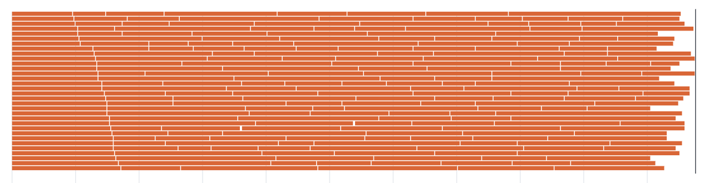

# Portable Batch System (PBS) Job Scripts

**Job scripts** form the basis of *batch jobs*.
A job script is simply a text file with instructions of the work to
execute.  Job scripts are *usually* written in `bash` or `tcsh` and
thus mimic commands a user would execute interactively through a
shell; but instead are executed on specific resources allocated by the
scheduler when available.  Scripts can also be written in other
languages - commonly Python.

!!! tip "Example Job Scripts"
    Example job scripts may be referenced on both the [Derecho Job Script Examples](./derecho-job-script-examples.md) and the [Casper Job Script Examples](./casper-job-script-examples.md) pages.

## Anatomy of a Job Script
Sample basic PBS scripts are listed below:
!!! example "PBS job scripts"
    === "bash"
        ```bash
        #!/bin/bash
        #PBS -N hello_pbs
        #PBS -A <project_code>
        #PBS -j oe
        #PBS -k eod
        #PBS -q main
        #PBS -l walltime=00:05:00
        #PBS -l select=2:ncpus=128:mpiprocs=128

        ### Set temp to scratch
        export TMPDIR=${SCRATCH}/${USER}/temp && mkdir -p $TMPDIR

        ### specify desired module environment
        module purge
        module load ncarenv/23.09 gcc/12.2.0 cray-mpich/8.1.25
        module list

        ### Compile & Run MPI Program
        mpicxx -o hello_world_derecho /glade/u/home/benkirk/hello_world_mpi.C -fopenmp
        mpiexec -n 256 -ppn 128 ./hello_world_derecho
        ```

        ---

        The first line denotes the interpreter to be used for the script:
        ```bash
        #!/bin/bash
        ```

    === "tcsh"
        ```tcsh
        #!/bin/tcsh
        #PBS -N hello_pbs
        #PBS -A <project_code>
        #PBS -j oe
        #PBS -k eod
        #PBS -q main
        #PBS -l walltime=00:05:00
        #PBS -l select=2:ncpus=128:mpiprocs=128

        source /etc/csh.cshrc

        ### Set temp to scratch
        setenv TMPDIR ${SCRATCH}/${USER}/temp && mkdir -p ${TMPDIR}

        ### specify desired module environment
        module purge
        module load ncarenv/23.09 gcc/12.2.0 cray-mpich/8.1.25
        module list

        ### Compile & Run MPI Program
        mpicxx -o hello_world_derecho /glade/u/home/benkirk/hello_world_mpi.C -fopenmp
        mpiexec -n 256 -ppn 128 ./hello_world_derecho
        ```

        ---

        The first line denotes the interpreter to be used for the script:
        ```tcsh
        #!/bin/tcsh
        ```

    === "Python"
        ```python
        #!/glade/u/apps/opt/conda/envs/npl/bin/python
        #PBS -N hello_pbs
        #PBS -A <project_code>
        #PBS -j oe
        #PBS -k eod
        #PBS -q main
        #PBS -l walltime=00:05:00
        #PBS -l select=1:ncpus=128:mpiprocs=128

        import sys
        print("Hello, world!!\n\n")

        print("Python version:")
        print(sys.version)
        print("Version info:")
        print(sys.version_info)
        ```

        ---

        The  first line denotes the interpreter to be used for the script:
        ```python
        #!/glade/u/apps/opt/conda/envs/npl/bin/python
        ```
        indicates this is a `python` script (and, specifically, the NCAR NPL instance).

**Focusing on the `bash` example for discussion**, the remainder of the script contains two main sections:

1.  The lines beginning with `#PBS` are **directives** that will be interpreted by PBS when this script is submitted with `qsub`.
    Each of these lines contains an instruction that will be used by `qsub` to control job resources, execution, etc...

2.  The remaining **script contents** are simply `bash` commands that will be run inside the batch environment on the selected resources and define the work to be done in this job.


### PBS directives

The example above contains several **directives** which are interpreted by the `qsub` submission program:

* `-N hello_pbs` provides a *job name*.  This name will be displayed by the scheduler for diagnostic and file output.  If omitted, and a script is used to submit the job, the job's name is the  name  of  the  script.
* `-A <project_code>` indicates which *NCAR Project Accounting code* resource allocation will be applicable to this job. (You will want to replace `<project_code>` with your project's specific code.)
* `-j oe` requests we *combine any standard text output (`o`) and error (`e`) into one output file*.
  (By default, PBS will write program output and error to different log files.  This behavior is contrary to what many users expect from terminal interaction, where output and error are generally interspersed. This optional flag changes that behavior.)
* `-q main` specifies the desired PBS *queue* for this job.
* `-l walltime=00:05:00` requests 5 minutes as the maximum job execution (*walltime*) time.  Specified in `HH:MM:SS` format.
* `-l select=2:ncpus=128:mpiprocs=128` is a computational *resource chunk* request, detailing the quantity and configuration of *compute nodes* required for this job. This example requests a *selection* of 2 nodes, where each node must have 128 CPU cores, each of which we will use as an MPI rank in our application.


### Script contents

The remaining script contains shell commands that define the job execution workflow.  The commands here are arbitrary, however we strongly recommend the general structure presented above.  This includes:

1.  **Explicitly setting the `TMPDIR` variable**.

    As described [here](../storing-temporary-files.md), many programs
    write temporary data to `TMPDIR`, which is usually small and
    shared among st users.  Specifying your own directory for temporary
    files can help you avoid the risk of your own programs and other
    users' programs failing when no more space is available.

2.  **Loading and reporting the specific module environment required for this job.**

    While strictly not necessary (in general, the system default modules will be loaded anyway), we recommend this as best practice as it facilitates debugging and reproducing later.  (While the system default modules will change over time, manually specifying module versions allows you to recreate the same execution environment in the future.)

4.  **(*Optional*) Defining any environment variables specific to the chosen module environment.**

    Occasionally users will want to define particular run time environment variables e.g. for a specific MPI or library chosen via the `module load` commands.


5.  **Remaining job-specific steps.**

    In the example above, we first compile and then execute `hello_world_mpi.C`, a simple MPI program.

---

## Common `#PBS` directives

### Resource requests
Resources (compute node configuration, job duration) are requested
through a combination of *resource selection* flags, each preceded
with `-l`.

For example:
```pre
#PBS -l walltime=00:05:00
#PBS -l select=1:ncpus=64:mpiprocs=4:ngpus=4:gpu_type=a100:mem=400GB
#PBS -l job_priority=economy
```
specifies job `walltime`, compute node selection, and job priority.  See more
details below.


#### `select` statements
Resources are specified through a `select` statement.  The general form of a *homogeneous* selection statement is
```pre
select=<# CHUNKS>:ncpus=<# CPU Cores/chunk>:mpiprocs=<# MPI Ranks/chunk>:ompthreads=<# OpenMP Threads/rank>:mem=<RAM/chunk>:ngpus=<# GPUs/chunk>
```
where

*  `<# CHUNK>` is the total number of compute "chunks" requested, followed by a colon-separated list of

*  `<# CPU Cores/chunk>` is the *total* number of CPUs requested *in each chunk*, which can be a mix of MPI Ranks and/or OpenMP threads,

*  `<# MPI Ranks/chunk>` is the number of MPI Ranks *in each chunk*. (Optional, defaults to 1),

*  `<# OpenMP Threads/chunk>` is the number of OpenMP ranks *per MPI Rank in each chunk*. (Optional, defaults to 1),

*  `<RAM/chunk>` is how much main memory (RAM) the job will be able to access *in each chunk*. (Optional, default is system dependent), and

*  `<# GPUs/chunk>` is the number of GPUs *per chunk*. (Optional, defaults to 0).

Taken together, this specifies a collection of like *resource chunks*. In Derecho's `main` queue, a chunk is synonymous with a node. However, in shared queues (e.g., `casper`), multiple chunks may get placed on the same compute node if sufficient resources are available. Homogeneous resource chunks are the most common case, however, *heterogeneous* selection statements can be constructed by multiple chunk specifications separated by a **+** (examples below).

##### Examples
*  4 128-core chunks, each running 128 MPI ranks (4 `x` 128 = 512 MPI ranks total).
   ```pre
   select=4:ncpus=128:mpiprocs=128
   ```

*  4 128-core chunks, each running 32 MPI ranks with 4 OpenMP threads per ranl (4 `x` 32 = 128 MPI ranks total, each with 4 threads = 512 total CPU cores).
   ```pre
   select=4:ncpus=128:mpiprocs=32:ompthreads=4
   ```

*  2 64-core chunks, each running 4 MPI ranks, 4 GPUS, and 384 GB memory (8 GPUs total, with 8 MPI ranks).
   ```pre
   select=2:ncpus=64:mpiprocs=4:ngpus=4:mem=384GB
   ```

*  4 36-core chunks, each running 4 MPI ranks, 4 GPUS configured with NVIDIA's Multi-Process Service (MPS), and 768 GB memory (16 GPUs total, with 16 MPI ranks).
   ```pre
   select=4:ncpus=36:mpiprocs=4:ngpus=4:mem=768GB:mps=1
   ```
   MPS is simply enabled via `mps=1`, and is disabled by default (`mps=0`)

*  A heterogeneous selection, 96 128-core chunks each with 128 MPI ranks, and 32 128-core chunks each with 16 MPI ranks and 8 OpenMP threads
   ```pre
   select=96:ncpus=128:mpiprocs=128+32:ncpus=16:ompthreads=8
   ```

The particular values for `ncpus`, `mem`, `ngpus` are node-type
dependent, and most NCAR systems have more than one available node
type. (See system specific documentation for
recommended values.)

!!! tip "Request all `ncpus` when running on exclusive nodes"
    For large multi-node jobs on machines like *Derecho* nodes are
    usually assigned exclusively to a single PBS job at a time.  For
    most use cases, users will request the maximum number of CPUS
    available via `ncpus`, and consume all through a combination of
    `mpiprocs` and `ompthreads`.

    Occasionally users may want fewer than the maximum CPUs for
    computation, "under-subscribing" compute nodes.  This is usually
    done for memory intensive applications, where some cores are
    intentionally left idle in order to increase the memory available
    for the running cores.  In such circumstances users should still
    request access to all CPUs, but only use a subset.  For example
    ```bash
    select=4:ncpus=128:mpiprocs=64:ompthreads=1:mem=235GB
    ```
    requests access to all 128 CPUs on a dedicated node, but only
    assigns 64 for MPI use.

    By requesting access to all `ncpus=128` is
    recommended for this case because it allows optimally locating the
    actually used `mpiprocs=64` across the compute node via *process
    binding*.

##### GPU and CPU Types
<!-- TODO -- add a link to a full type table -->
!!! warning
    Prior to the November 2025 maintenance, the `gpu_type` attribute was
    specified as a job resource:

    ```
    #PBS -l gpu_type=a100
    ```

    After the maintenance, the attribute should be specified as a chunk resource
    as documented below. **The old syntax is no longer supported.**

For highly heterogeneous systems such as Casper, a resource chunk
statement requesting GPUS may match more than one particular GPU type.
The resource specification `gpu_type=...` allows you to narrow the
range of hardware your job can be assigned. The `gpu_type` attribute
is specified on chunks in your select statement:

```
#PBS -l select=1:ncpus=64:mpiprocs=4:ngpus=4:gpu_type=a100:mem=400GB
```

Valid values for GPU type take multiple forms, including:

* Specific GPU architectures (e.g., `h100`)
* GPU architectures with devices per node (e.g., `v100_8way`)
* GPU architectures with per-device VRAM (e.g., `h100_80gb`)
* Generic compute capability (e.g., `cc80`)

If you specify a generic compute capability, your chunk could be assigned any
available GPU that supports that capability. For example, specifying `cc80`
could result in your chunk being assigned NVIDIA A100, H100, or newer GPUs.
Visualization GPUs (e.g., *l40*) are considered distinct and will not be
considered when giving a compute capability for `gpu_type`.

An analogous resource - `cpu_type` - exists to request a specific CPU
architecture for your chunk. This is less commonly used than `gpu_type`, but can
be useful if you want to ensure your compilation happens on a specific CPU
generation (e.g., `cpu_type=milan`).

#### `walltime`
The `-l walltime=HH:MM:SS` resource directive specifies maximum job
duration. Jobs still running when this wall time is exceeded will be
terminated automatically by the scheduler.
```pre
walltime=HH:MM:SS
```

#### `job_priority`
Users may request a specific job priority with the `-l job_priority=...`
resource directive.
Valid options are:
```pre
job_priority=<regular|premium|economy>
```
Job priority impacts both scheduling and resource accounting, allowing users to
run at a higher/lower priority in exchange for additional/reduced allocation
consumption.  See
[here](../../compute-systems/derecho/derecho-use-policies.md#job-priority) for
additional information.

### Other frequently used `#PBS` directives

| <div style="width:160px">Directive</div> | Impact |
|---------------------|----------------------------------------------------------------------------------------------------------------------------------------------------------------------------------------------------------------------------------------------------------------------------------------------------------------------------------------------------------------------------------------------------------------------------------------|
| `-A <project_code>` | NCAR Project Accounting  string  associated  with  the  job.                                                                                                                                                                                                                                                                                                                                                                           |
| `-a <date at time>`  | Allows users to request a future  *eligible time* for job execution.<br>(By default jobs are considered immediately eligible for execution.)<br> Format: `[[[YY]MM]DD]hhmm[.SS]`                                                                                                                                                                                                                                                       |
| `-h`                | Holds the job.<br><Held jobs can be released with `qrls`.                                                                                                                                                                                                                                                                                                                                                                                |
| `-I`                | Specifies **interactive** execution.<br>Interactive jobs place the user a login session on the first compute node.<br>Interactive jobs terminate when the shell exits, or `walltime` is exceeded.                                                                                                                                                                                                                                      |
| `-J <range>`        | Specifies an **array job**.<br>Use  the range argument to specify the indices of the sub jobs of the array.  range is specified in the form `X-Y[:Z]` where `X` is the first index, `Y` is the upper bound on the indices, and `Z`  is  the  stepping factor. Indices must be greater than or equal to zero.<br><br>Use the optional `%max_subjobs` argument to set a limit on the number of subjobs that can be running  at  one time.<br><br>[more details on array jobs](#pbs-job-arrays) |
| `-m <mail events>`   | Sends email on specific events (may be combined).<br>`n`: No mail is sent<br>`a`: Mail is sent when the job is aborted by the batch system<br>`b`: Mail is sent when the job begins execution<br>`e`:  Mail is sent when the job terminates<br><br>Example: `-m abe` |
| `-M <address(es)>` | List of users to whom mail about the job is sent.<br>The user list argument has the form: `<username>[@<hostname>][,<username>[@<hostname>],...]` |


!!! info "`qsub` arguments take precedence over `#PBS` directives"
    Best practice is to fully specify your PBS queue, job name, and resources in your job script as shown above. This allows for better debugging and facilitates reproducing runs in the future.    When a job's PBS attributes are fully specified, you can usually submit the script with no additional arguments, for example
    ```bash
    qsub script.pbs
    ```
    (See [Running Jobs](../index.md) for more details on interacting with the scheduler.)

    ---

    On occasion users may want to change some of the PBS parameters
    without modifying the job script.  A common example may be the
    account code, the job name (`-N`) or even the `walltime`.

    Any `#PBS` directives specified in the job script can be
    overridden at submission time by equivalent arguments to `qsub`.
    For example,
    ```bash
     qsub -A <OTHER_ACCOUNT> \
          -N testing \
          -l job_priority=premium \
          script.pbs
    ```
    will run `script.pbs` under the specified `<OTHER_ACCOUNT>`
    with the job name `testing` and requests `premium` priority,
    regardless of what other values may be specified in `script.pbs`


## Execution environment variables
Within the **script contents** of the job script, it is common for the
specifics of the job to depend slightly on the PBS and specific
`module` execution environment.  Both running under PBS and loading
certain [module files](../../environment-and-software/user-environment/modules.md)
create some environment variables that might be useful when writing
portable scripts; for example scripts that might be shared among users
or executed within several different configurations.

!!! tip "Use common environment variables to write portable PBS batch scripts"
    Avoid hard-coding paths into your shell scripts if instead any of
    the environment variables below might be used.  This will
    facilitate moving scripts between systems, users, and application
    versions with minimal modifications, as output paths can be
    defined generically as opposed to hard-coded for each user.


### PBS execution environment variables
PBS creates a number of environment variables that are accessible within a job's execution environment.
Some of the more useful ones are:


|  <div style="width:110px">Variable</div> | Value |
|---------------|-------|
| `PBS_ACCOUNT`   | The NCAR Project Accounting code used for this job. |
| `PBS_JOBID`     | The PBS Job ID for this job.<br>Example: `1473351.desched1` |
| `PBS_JOBNAME`   | The name of this job. Matches the `-N` specified.<br>Example: `hello_pbs` |
| `PBS_O_WORKDIR` | The working directory from where the job was submitted. |
| `PBS_SELECT`    | The resource specification `-l select=` line for this job.<br>This can be useful for setting runtime-specific configuration options that might depend on resource selection.<br>(e.g. processor layout, CPU binding, etc...)<br>Example: `2:ncpus=128:mpiprocs=2:ompthreads=2:mem=200GB:Qlist=cpu:ngpus=0`  |
| `PBS_NODEFILE`  | A file whose contents lists the nodes assigned to this job.<br> Typically listed as one node name per line, for each MPI rank in the job.<br>Each node will be listed for as many times as it has MPI ranks. <br>Example: `/var/spool/pbs/aux/1473351.desched1` |

<!-- | `PBS_QUEUE`     | The name of the PBS execution queue.<br>In general this will be an *execution* queue, and different than the *routing* queue specified by `-q` in the job script.<br>Example: `cpu` | -->


### NCAR `module`-specific execution environment variables

| <div style="width:200px">Variable</div>                  | Value                                                                                                           |
|----------------------------------------------------------|-----------------------------------------------------------------------------------------------------------------|
| <p style="text-align: center;"><strong>Machine and Software Environment</strong></p> {: colspan=2} |
| `NCAR_HOST`                                              | Specifies the *host class* of machine, e.g. `derecho` or `casper`                                               |
| `NCAR_BUILD_ENV_COMPILER`                                | A unique string identifying the host and compiler+version currently loaded.<br>Example: `casper-oneapi-2023.2.1` |
| `NCAR_BUILD_ENV_MPI`                                     | A unique string identifying the host, compiler+version, and mpi+version currently loaded.<br> Example: `casper-oneapi-2023.2.1-openmpi-4.1.5` |
| `NCAR_BUILD_ENV`                                         | A unique string identifying the current *build environment*, identical to `NCAR_BUILD_ENV_MPI` when an MPI module is loaded, or `NCAR_BUILD_ENV_COMPILER` if only a compiler is loaded. |
| `LMOD_FAMILY_COMPILER`<br>`LMOD_FAMILY_COMPILER_VERSION` | Specifies the type and version of compiler currently loaded, if any.<br>Example:`intel`, `gcc`, `nvhpc`         |
| `LMOD_FAMILY_MPI`<br>`LMOD_FAMILY_MPI_VERSION`           | Specifies the type and version of MPI currently loaded, if any.<br>Example:`openmpi`, `cray-mpich`, `intel-mpi` |
| <p style="text-align: center;"><strong>User and File System Paths</strong></p> {: colspan=2} |
| `${USER}`    | The `username` of user executing the script. |
| `${HOME}`    | The GLADE home file space for the user executing the script.<br>Example: `/glade/u/home/${USER}` |
| `${WORK}`    | The GLADE work file space for the user executing the script.<br>Example: `/glade/work/${USER}` |
| `${SCRATCH}` | The GLADE scratch file space for the user executing the script.<br>Example: `/glade/derecho/scratch/${USER}` |

---

## PBS Job Arrays
Occasionally users may want to execute a large number of similar jobs.
Such workflows may arise when post-processing a large number of
similar files, for example, often with a serial post-processing tool.
One approach is simply to create a unique job script for each.  While
simple, this approach has some drawbacks, namely scheduler overhead
and job management complexity.

PBS provides a convenient **job array** mechanism for such cases. When
using job arrays, the queue script contents can be thought of as a
template that is applied repeatedly, for different instances of the
`PBS_ARRAY_INDEX`.  Consider the following example:

!!! example "PBS job array"

    Suppose your working directory contains a number of files `data.year-2010`, `data.year-2011`, ..., `data.year-2020`.  You would like to run `./executable_name` on each.
    ```bash title="job_array.pbs"
	#PBS -N job_array
	#PBS -A <project_code>
	### Each array sub-job will be assigned a single CPU with 4 GB of memory
	#PBS -l select=1:ncpus=1:mem=4GB
	#PBS -l walltime=00:10:00
	#PBS -q casper
	### Request 11 sub-jobs with array indices spanning 2010-2020 (input year)
	#PBS -J 2010-2020
	#PBS -j oe

	export TMPDIR=${SCRATCH}/temp
	mkdir -p ${TMPDIR}

	### Run program on a specific input file:
	./executable_name data.year-${PBS_ARRAY_INDEX}
	```

    The directive `-J 2010-2020` instructs the scheduler to launch a number of *sub-jobs*, each with a distinct value of `PBS_ARRAY_INDEX` spanning from 2010 to 2020 (inclusive).

    The `-l select=1:ncpus=1:mem=4GB` resource chunk and `-l walltime=00:10:00` run time limit **applies to each sub-job**.

PBS job arrays provide a convenient mechanism to launch a large number
of small, similar jobs. The approach outlined above is particularly
suitable for Casper, where nodes are typically shared and individual
CPU cores are scheduled.  This allows a job array sub-job to be as small as a single core.

When entire compute nodes are assigned to jobs (and therefore also array sub-jobs) we need a slightly different approach,
as employed in the following use case.

### Using job arrays to launch a "command file" with `launch_cf`
The multiple program multiple data (MPMD) method runs
executables with independent inputs simultaneously. Such jobs can easily be
dispatched with PBS job arrays, even on machines like Derecho where
compute nodes are exclusively and entirely assigned to a users'
job. This process is outlined in the example below.

!!! example "`launch_cf` and a Command File gives MPMD jobs with PBS Job Arrays"
    For this example, executable commands appear in a command file (`cmdfile`).

    ```bash title="cmdfile"
    # this is a comment line for demonstration
    ./cmd1.exe < input1 # comments are allowed for steps too, but not required
    ./cmd2.exe < input2
    ./cmd3.exe < input3
    ...
    ./cmdN.exe < inputN
    ```

    The command file, executables, and input files should all reside
    in the directory from which the job is submitted. If they don't,
    you need to specify adequate relative or full paths in both your
    command file and job scripts.  The sub-jobs will produce output
    files that reside in the directory in which the job was submitted.
    The command file can then be executed with the `launch_cf` command.

    **Examples**:
    ```pre
    # launches the commands listed in ./cmdfile:
    launch_cf -A PBS_ACCOUNT -l walltime=1:00:00

    # launches the OpenMP-threaded commands listed in ./omp_cmdfile:
    #  requires ppn=128 = (32 steps/node) * (4 threads/step)
    launch_cf -A PBS_ACCOUNT -l walltime=1:00:00 --nthreads 4 --steps-per-node 32 ./omp_cmdfile

    # gives each node 3 waves of 128 steps (384 steps per node on Derecho):
    launch_cf -A PBS_ACCOUNT -l walltime=3:00:00 --waves 3 ./cmdfile

    # the same, giving the number of steps per node instead:
    launch_cf -A PBS_ACCOUNT -l walltime=3:00:00 --steps-per-node 384 ./cmdfile

    # writes the PBS job script and reports what would be requested, without submitting it:
    launch_cf -A PBS_ACCOUNT -l walltime=1:00:00 --dry-run ./cmdfile
    ```

    The jobs listed in the `cmdfile` will be launched from a `bash` shell in the
    users default environment.  The optional file `config_env.sh` will be "sourced"
    from the run directory in case environment modification is required, for example to
    load a particular `module` environment, to set file paths, etc...

    The command will assume reasonable defaults on Derecho and Casper for the number of
    job "steps" from the `cmdfile` to run per node, memory per node, PBS queues, etc...
    Each of these parameters can be controlled via `launch_cf` command line arguments,
    see `launch_cf --help`:
    ```pre title="launch_cf command line options"
    launch_cf <-h|--help>
         <-q|--queue PBS_QUEUE>
         <--ppn|--processors-per-node #CPUS>
         <--steps-per-node #Steps/node | --nodes #Nodes | --waves #Waves>
         <--nthreads|--threads-per-step #Threads/step>
         <--sync-waves>
         <--mem|--memory RAM/node>
         <--cpu_type TYPE>
         <--random_start_delay MAX_DELAY (sec)>
         <--script PBS_SCRIPT_NAME>
         <--rerun JOBID>
         <--dryrun|--dry-run>
         -A PBS_ACCOUNT -l walltime=01:00:00
         ... other PBS args ...
         <command file>

    ------------------------------------------------------------------
    All options in "<>" brackets are optional.
    Any unrecognized arguments are passed through directly to qsub.
    The PBS options -A and -l walltime are required at minimum.
    ```

    The two PBS required arguments are `-A <project_code>` and `-l walltime=...`.
    Any command line argument not interpreted directly by `launch_cf` are assumed PBS
    arguments and are passed along to `qsub`.

---

**Running more steps per node than fit at once with "waves" in `launch_cf`**

Each node runs up to (CPUs ÷ threads per step) steps at once. A Derecho node with 128
cores and one thread per step will run 128 steps at once by default. With `--nthreads 4`,
it will run 32 steps at once.
A node can be given more steps than that, however. It then starts its next step
each time a running one finishes, so its steps run in *waves*.
This lets a large command file run on fewer nodes. See the Figure below.

There are two ways to ask for it:

- **`--waves N`** gives each node *N* waves of steps, that is, *N* times as
  many steps as it runs at once, so you don't have to work out the number yourself.
  On Derecho, `--waves 3` gives each node 3 × 128 = 384 steps, and
  `--nthreads 4 --waves 3` gives it 3 × 32 = 96.
  The CPUs per node come from `--ppn` or the system default. On Casper the default is
  one CPU, which would mean one step at a time, so give `--ppn` as well,
  e.g. `--ppn 34 --waves 3`.
  The command file must have enough steps to fill that many waves (for 3 waves
  of 128 at once, more than 256 steps); otherwise `launch_cf` stops and
  says how many waves the steps fill.
- **`--steps-per-node N`** with *N* larger than the steps a node runs at once, will run
  multiple waves per node. For example, on Derecho `--steps-per-node 384` gives the
  same 3 waves of 128 as `--waves 3`.  If `--ppn M` is also given, each node is
  will run *M* steps at once. Any steps beyond that will run in waves. For example,
  if `--ppn 64` is given in this example, the 384 steps will run in 6 waves.

<figure markdown="span">
  <figcaption markdown="span" style="max-width: 100%; text-align: left; margin-top: 0.4em; font-size: 0.7rem">**Figure:** One node with 256 steps and 32 slots (specified by `-ppn 32`) running 8 overlapping waves. Each row is a slot, and each bar is one step. Time runs left to right.  A slot starts its next step as soon as its current one finishes, so the node stays busy until its last steps finish.</figcaption>
</figure>


!!! warning "`--ppn` with a larger `--steps-per-node` now runs in waves"
    Earlier versions of `launch_cf` raised `--ppn` to fit all of a node's steps at once.
    `launch_cf` now requests the CPUs `--ppn` gives, and runs the steps that don't fit
    in waves. For example, `--ppn 32 --steps-per-node 64` used to run 64 steps at once
    on 64 CPUs; it now runs them 32 at a time, in 2 waves, which takes about twice as long.
    To run them all at once, leave out `--ppn` or give a larger one. If you have scripts
    written for the old behavior, check that their walltime allows for the waves.
    `launch_cf` points this out when it happens.

Give only one of `--waves`, `--steps-per-node` and `--nodes`.
`launch_cf` reports how the steps will run, for example:
```pre
Running 3 jobs with 384 steps / node on NCAR resource derecho
NOTE: --waves 3: each node runs 128 steps at once (128 CPUs / 1 thread per step),
      so it is given 3 x 128 = 384 steps, in 3 waves.
      The last node has only the 232 steps left over, in 2 waves.
      Request walltime for up to 3 steps in a row.
```

By default, a node starts its next step as soon as any running step finishes, so its
waves overlap. With **`--sync-waves`**, a node starts its next wave only after every
step of the wave before it has finished. This is useful when steps bind their threads
to particular cores, using `numactl` for example. `--sync-waves` prevents a step of a wave from landing on cores still in use by the previous step.
The cost is that each wave takes as long as its longest step.

!!! tip "Running multiple waves per node can save core hours"
    If your command execution times vary from step to step, you can run
    more efficiently by using one or a few nodes with multiple waves.
    It reduces overhead for job startup and allows load balancing,
    because a new wave of steps doesn't wait until all the steps per node from
    a previous wave completes. This is sometimes referred to as task oversubscription,
    and the Figure above illustrates the concept. This scenario is likely to be in play
    when IO is involved, the tasks are memory bound, or the steps are a mix of different
    commands.

---

**Rerunning the steps that didn't succeed: `--rerun`**

`launch_cf --rerun JOBID` finds the steps of an earlier `launch_cf` job that didn't
succeed, such as steps that exited with an error, steps cut short when
a node ran out of walltime or memory or was preempted, and steps that never ran. It then submits
just those in a new job, automatically taking care of step numbers and properly naming files.
Run it from the directory the earlier job was submitted from, once that job has finished:
```pre
launch_cf -A PBS_ACCOUNT -l walltime=0:10:00 --rerun 6285048
Job 6285048: 1 of 1200 steps did not succeed:
  step 332 of job 6285048: never ran: subjob 331 did not run
Wrote ./cmdfile.6285048.rerun, to submit as the command file.
...
```

- The steps are written to a new command file, `./<command file>.<JOBID>.rerun`, with a
  comment saying why each is rerun, and submitted like any other. Add `--dry-run` to see
  the list without submitting it.
- The other options aren't taken from the earlier job. Give `-A`, `-l walltime=` and any
  others again, and choose `--steps-per-node`, `--nodes` or `--waves` for the smaller
  number of steps.
- Each rerun step keeps its step number from the original job, in its `${step}` variable
  and in the name of its log file, so steps that use it to name their output write the
  same files as before.
- `--rerun` stops if the job is still queued or running, or if `qstat` can't reach PBS to
  check.
- On Derecho, a preempted job is deleted rather than put back in the queue. `--rerun` is
  the way to run the steps it didn't finish.

---

**Checking a job before submitting it: `--dry-run`**

`launch_cf` writes a complete, self-contained PBS job script to the current directory,
and that script is what it submits. Every resource request appears in it as an
ordinary `#PBS` directive.  With `--dry-run` (or `--dryrun`), `launch_cf`
writes the script and reports what it would request (nodes, steps per node, waves),
but does not submit anything:
```pre
launch_cf -A PBS_ACCOUNT -l walltime=3:00:00 --waves 3 --dry-run ./cmdfile
...
Generated PBS job script: ./launch_cf.cmdfile.20261117-100358.pbs
...
DRYRUN: nothing was submitted.  To submit this job as-is, run:
  qsub ./launch_cf.cmdfile.20261117-100358.pbs
```
This is a convenient way to check the job's size and walltime before it goes in the queue,
especially when using waves.  The script can then be submitted as-is with `qsub`, or
edited first, without running `launch_cf` again.  Use `--script` to choose the
script's name.

---

!!! tip "Request walltime for every wave"
    `launch_cf` cannot know how long your steps take. Each node's steps now run
    one after another in several waves, so request enough walltime for that many
    steps in a row, e.g. three times the run time of your longest step for `--waves 3`.

**Discussion**

This PBS array implementation is a departure from the command file technique
used previously on Cheyenne, where MPI was used to launch the desired commands on each rank.  While slightly more complex,
the array approach has several advantages.  Since the array steps are independent, the job can begin
execution as soon as even a single node is available, and can scale to fill the available resources. This
approach, while convenient for high throughput, will usually cost more core hours and can negatively
impact the queues.

Additionally, the array approach is well suited for when the run times of the specific commands varies.
In the previous MPI approach, all nodes were held until the slowest step completed, with the consequence
of idle resources for varied command run times. With the array approach each node completes independently,
when the slowest of its unique steps has completed.  Thus the utilization of *each node* is controlled by
the run times of its own steps, rather than all steps.

---

The implementation details are unimportant for general users exercising this
capability, however may be interesting for advanced users wishing to leverage
PBS job arrays in different scenarios.  See the
[hpc-demos GitHub repository](https://github.com/NCAR/hpc-demos/tree/main/PBS/job_arrays/command_files)
for source code.

<!--  LocalWords:  mpiprocs MPI ompthreads OpenMP mem ngpus GPUs  ncpus
 -->
